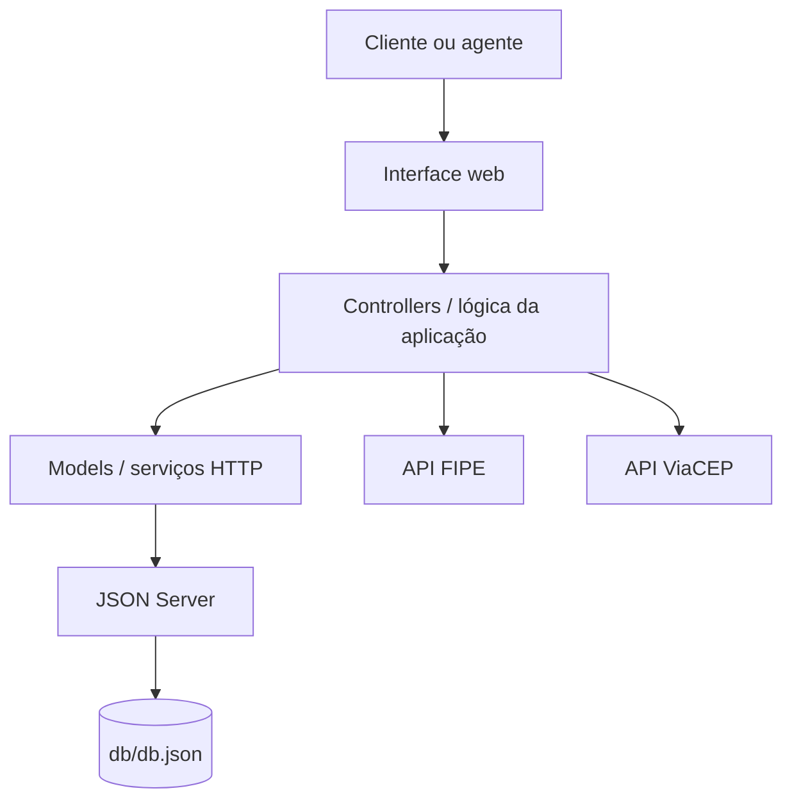

# VÉRTICE — Plataforma de aluguel de veículos
<table>
  <tr>
    <td width="800px">
      <div align="justify">
        Plataforma web demonstrativa para consulta de veículos, solicitação de aluguéis e gerenciamento de frota. A VÉRTICE aproxima clientes e agentes em uma experiência de locação com foco em praticidade, organização e apresentação visual.
      </div>
    </td>
    <td>
      <div>
        
      </div>
    </td>
  </tr> 
</table>

---

## 🚧 Status do projeto

**Projeto acadêmico concluido.**

A aplicação possui interface web, dados locais servidos pelo JSON Server e integrações com serviços públicos. Não é um sistema de produção: autenticação, armazenamento de imagens e persistência foram simplificados para fins de demonstração.


---

## 📚 Índice

- [Sobre o projeto](#-sobre-o-projeto)
- [Funcionalidades principais](#-funcionalidades-principais)
- [Tecnologias utilizadas](#-tecnologias-utilizadas)
- [Arquitetura](#-arquitetura)
- [Instalação e execução](#-instalação-e-execução)
- [Contas demonstrativas](#-contas-demonstrativas)
- [API e dados](#-api-e-dados)
- [Estrutura de pastas](#-estrutura-de-pastas)
- [Integrações externas](#-integrações-externas)
- [Demonstração](#-demonstração)
- [Testes e validação](#-testes-e-validação)
- [Autores](#-autores)

---

## 📝 Sobre o projeto

A **VÉRTICE** é uma aplicação web de aluguel de veículos desenvolvida como projeto acadêmico. Seu objetivo é oferecer um ambiente no qual clientes possam consultar veículos disponíveis e solicitar locações, enquanto agentes podem administrar o inventário e acompanhar as solicitações recebidas.

O sistema reúne uma vitrine de veículos, formulários de autenticação e perfil, estimativa do valor da locação e uma área administrativa para cadastro e manutenção dos veículos. O projeto também utiliza serviços externos para auxiliar no preenchimento de informações de veículos e endereços.

---

## ✨ Funcionalidades principais

### Cliente

- Criar uma conta e entrar no sistema.
- Consultar os veículos cadastrados e visualizar suas informações.
- Filtrar a frota por categoria.
- Informar datas de retirada e devolução.
- Visualizar uma estimativa do preço com base no valor da diária e no período informado.
- Enviar solicitações de aluguel e acompanhar seu andamento.
- Consultar e atualizar os dados do próprio perfil.
- Excluir a própria conta na versão demonstrativa.

### Agente

- Entrar com uma conta de agente.
- Acessar a área de gestão da frota.
- Cadastrar, editar e excluir veículos.
- Informar marca, modelo, ano, placa, registro, categoria, diária, quilometragem, câmbio, combustível, quantidade de lugares, proprietário, disponibilidade e localização.
- Enviar imagem do veículo nos formatos JPG, PNG ou WEBP, respeitando o limite indicado no formulário.
- Consultar e analisar solicitações de aluguel, aprovando ou recusando pedidos.

### Interface

- Layout responsivo com Bootstrap.
- Vitrine com destaque para veículos.
- Animação discreta de partículas que acompanha o ponteiro em dispositivos compatíveis.
- Respeito à preferência do navegador por redução de movimento.
- Imagem local de substituição quando uma imagem de veículo não puder ser carregada.

---

## 🛠 Tecnologias utilizadas

### Front-end

- **HTML5:** estrutura das páginas e formulários.
- **CSS3:** estilos, layout, animações e identidade visual.
- **Bootstrap 5:** componentes e responsividade.
- **JavaScript (ES Modules):** interações, validações e comunicação com a API.

### Back-end demonstrativo e persistência

- **Node.js:** ambiente necessário para executar as ferramentas do projeto.
- **JSON Server 0.17.4:** API REST simulada a partir de `db/db.json`.
- **HTTP Server:** servidor estático para disponibilizar a interface web.
- **Concurrently:** inicialização dos servidores web e da API com um único comando.

### Serviços externos

- **FIPE:** consulta auxiliar de marcas e modelos de veículos.
- **ViaCEP:** consulta de endereço a partir do CEP.

> O projeto não utiliza React, Vite, Java, Spring Boot, PostgreSQL, Docker ou ORM nesta versão.

---

## 🏗 Arquitetura

A proposta de organização do sistema é baseada no padrão **MVC (Model–View–Controller)**:

- **Model:** representa os dados e concentra o acesso à API.
- **View:** apresenta os dados e atualiza os elementos da interface.
- **Controller:** coordena as ações do usuário, as regras da aplicação e a comunicação entre Model e View.
- **Serviços:** encapsulam chamadas HTTP e integrações externas.
- **JSON Server:** disponibiliza os recursos persistidos no arquivo JSON.

### Visão geral do fluxo



A separação está implementada em módulos JavaScript: `app.js` funciona como ponto de entrada e instancia os componentes; os Controllers coordenam os fluxos da aplicação; os Models acessam os recursos da API; a View atualiza a interface; e `ApiService` centraliza as requisições HTTP. A autenticação é demonstrativa e não representa uma barreira de segurança no servidor.

---

## 🔧 Instalação e execução

### Pré-requisitos

- Node.js 18 ou superior.
- npm (instalado junto com o Node.js).
- Navegador atualizado.

### Instalar dependências

Na pasta raiz do projeto, execute:

```bash
npm install
```

### Iniciar a aplicação

```bash
npm start
```

O comando inicia os dois serviços definidos no `package.json`:

| Serviço | Endereço | Finalidade |
|---|---|---|
| Interface web | http://localhost:5500 | Aplicação no navegador |
| JSON Server | http://localhost:3000 | API REST local |

Para verificar a API, acesse http://localhost:3000/cars. A rota deve retornar a coleção de veículos cadastrados em `db/db.json`.

> Abra a aplicação por `http://localhost:5500`. Não abra o arquivo `public/index.html` diretamente pelo sistema de arquivos (`file://`).

### Encerrar

No terminal em que `npm start` está em execução, pressione `Ctrl + C`.

---

## 🔐 Contas demonstrativas

As contas abaixo estão cadastradas inicialmente em `db/db.json`:

| Perfil | E-mail | Senha |
|---|---|---|
| Cliente | `cliente@demo.com` | `123456` |
| Agente | `agente@demo.com` | `123456` |

Essas credenciais são exclusivamente para demonstração. Não utilize senhas reais ou dados pessoais neste ambiente.

---

## 🔌 API e dados

O JSON Server utiliza o arquivo `db/db.json` como base de dados. A estrutura inicial contém as coleções:

- `users`: contas de clientes e agentes.
- `cars`: veículos disponíveis para consulta e administração.
- `rentals`: solicitações de aluguel.

Rotas REST disponibilizadas pelo JSON Server:

| Método | Rota | Uso |
|---|---|---|
| GET | `/users` | Consultar usuários |
| POST | `/users` | Criar conta |
| PATCH | `/users/:id` | Atualizar cadastro |
| DELETE | `/users/:id` | Excluir cadastro |
| GET | `/cars` | Consultar veículos |
| POST | `/cars` | Cadastrar veículo |
| PATCH | `/cars/:id` | Atualizar veículo |
| DELETE | `/cars/:id` | Excluir veículo |
| GET | `/rentals` | Consultar solicitações |
| POST | `/rentals` | Criar solicitação |
| PATCH | `/rentals/:id` | Atualizar situação da solicitação |

O JSON Server também permite filtros e consultas por parâmetros, conforme sua documentação. As rotas acima representam os recursos usados/previstos pela aplicação, não uma API de produção com autenticação e autorização no servidor.

---

## 🌐 Integrações externas

### FIPE

Base utilizada: `https://parallelum.com.br/fipe/api/v1`

A consulta auxilia o preenchimento de marca e modelo no cadastro de veículos. Se o serviço estiver indisponível, os campos podem ser preenchidos manualmente.

### ViaCEP

Base utilizada: `https://viacep.com.br/ws`

A consulta permite buscar informações de endereço a partir do CEP informado no formulário de cadastro do veículo.

### Efeito do ponteiro

O rastro visual do mouse é desenhado localmente em um elemento `canvas` por JavaScript. **Ele não depende de uma API externa.** O efeito é desativado em dispositivos sem ponteiro preciso e quando o navegador informa a preferência `prefers-reduced-motion`.

---

## 📂 Estrutura de pastas

```text
.
├── db/
│   └── db.json                 # Dados iniciais do JSON Server
├── public/
│   ├── assets/
│   │   ├── css/
│   │   │   └── style.css
│   │   ├── images/
│   │   │   └── car-placeholder.svg
│   │   └── js/
│   │       ├── app.js                    # Inicialização e integração dos módulos
│   │       ├── controllers/
│   │       │   ├── AuthController.js
│   │       │   ├── CarAdminController.js
│   │       │   ├── CarController.js
│   │       │   └── RentalController.js
│   │       ├── models/
│   │       │   ├── CarModel.js
│   │       │   ├── RentalModel.js
│   │       │   └── UserModel.js
│   │       ├── services/
│   │       │   └── ApiService.js
│   │       └── views/
│   │           └── AppView.js
│   ├── index.html
|   └── index.html.tmp
├── package.json
└── README.md
```

Os módulos JavaScript estão separados por responsabilidade, conforme a arquitetura MVC descrita acima. O arquivo `app.js` conecta os módulos e registra os eventos da interface.

---

## 🎥 Demonstração

Para melhor visualização, as telas principais estão organizadas lado a lado.

| Telas |  | 
| :---: | :---: |
| **Página Inicial (Home)** | **Página de Projetos** |
|  |  |
| **Pagina de Experiências** | **Pagina de Contato** |
|  |  |


- Página inicial e vitrine de veículos.
- Formulário de login e cadastro.
- Solicitação de aluguel e estimativa de preço.
- Perfil do cliente.
- Painel do agente e formulário de cadastro de veículos.
- Lista de solicitações de aluguel.

---

## 🧪 Testes e validação

### Para os casos de teste use:

#### Agente
Aba dos agentes:
- agente@demo.com
- 123456

Roteiro de validação do cliente:
1. Entrar como agente.
2. Abrir a gestão da frota e testar o CRUD de veiculos.
3. Entrar como agente e testar aprovação e reprovação de solicitações pendentes. 
4. Testar API da tabela FIPE, ao colocar marca e depois modelo, caso aparecer está correto.
5. Testar API do CEP, ao colocar cep o endereço deve aparecer.


#### Cliente
Aba dos clientes:
- cliente@demo.com
- 123456

Casos de teste de cliente:
1. Entrar como cliente. 
2. Atualizar cadastro como cliente. 
3. Gerar ordem de serviço ao pressionar reservar em um carro desejado.
4. Selecionar meus pedidos para cancelar o pedido.
5. Selecionar meus pedidos para editar a ordem de pedido
4. Conferir se o cliente visualiza apenas os próprios pedidos e consegue cancelar um pedido pendente.

#### Geral
Roteiro de validação geral:
1. Executar `npm install` e `npm start`; confirmar que a interface abre sem erros no console.
2. Acessar `http://localhost:3000/cars` e conferir os veículos retornados pela API.

---

## 📖 Documentações utilizadas

- [JSON Server 0.17](https://github.com/typicode/json-server/tree/v0.17.4)
- [Bootstrap 5](https://getbootstrap.com/docs/5.3/getting-started/introduction/)
- [Node.js](https://nodejs.org/docs/)
- [FIPE — API de consulta](https://parallelum.com.br/fipe/api/v1)
- [ViaCEP](https://viacep.com.br/)

---

## 👥 Autores

| Nome | GitHub |
|------|--------|
| Renato Teixeira Miranda Guimarães | [@Servor234](https://github.com/Servor234) |


---

